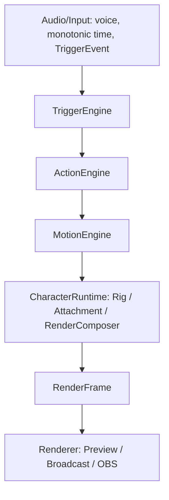

# VoxPet 2.0 Runtime과 App 연결

[전체 개발 계약](../product/voxpet-2-migration.md)과 [패키지 규격](../product/voxpet-package-format.md)을 구현하는 중앙 경계다. Phase 9 연결은 [완료 계획](../exec_plans/completed/plan-036-app-runtime.md)과 [자체 리뷰](../reviews/plan-036-app-runtime-review.md)의 Windows/OBS 검증을 통과했다. Phase 10은 [완료 계획](../exec_plans/completed/plan-037-character-editor.md)의 실제 Dashboard/library/editor로 연결했다. 최종 [Legacy 검토](legacy-migration-review.md)에서 현재 참조와 보존 이유를 분류한다.

## 전체 pipeline

CharacterRuntime이 위 engine을 소유·조정한다. 실제 Update는 기존 action 시각을 먼저 진행하고 같은 tick의 trigger/manual 요청·자동 대기열을 처리한 뒤 motion·priority·rig·attachment를 합성한다. renderer가 engine을 호출하거나 원본 형식을 분기하지 않는다. VoiceLevel은 유한0~1, caller time은 monotonic seconds, event time은 ms다. 정의/배열/dictionary는 입력을 복사한 읽기 전용 snapshot이고 Runtime의 가변 상태는 UI thread 한 곳이 소유한다.

## 데이터와 실행

Core CharacterDefinition은 PNG 상대 asset ID, Anchor 계층, mouth/expression/pose/action/attachment/motion의 불변 snapshot이다. LegacyImageSetSource와 LegacySpriteSheetSource, VoxPetPackageSource가 원본을 준비한다. CharacterRuntime은 호출자가 제공한 monotonic time/voice/input으로 TriggerEngine → ActionEngine → MotionEngine → RigMotionSolver → AttachmentSystem → RenderComposer를 실행한다.

RenderFrame의 layer 순서, opacity, affine matrix, 논리 크기, mesh와 viewport transform은 최종 출력이다. WPF MotionSurface/RenderFrameDrawing은 frozen asset map을 조회해 그린다. 입 단계, 표정, 우선순위, 착용 충돌, Anchor 상속과 타임라인 판단은 renderer에 없다. canvas 좌표는 Viewbox 안에 있고 body bounce DIP는 바깥 OutputTransform에서 유지한다.

## App 책임

CharacterRuntimeCoordinator는 legacy animator/손동작 시간축과 ImageSet/native 선택을 조정한다. MainViewModel은 고수준 명령·설정·앱 수명·마이크 UI 결과와 시간을 전달한다. 실제 오디오 callback과 자원 수명은 기존 AudioCaptureService/AudioSession 경계를 유지한다. 두 창은 동일 CharacterViewModel과 Runtime scene을 참조한다.

CharacterRuntimeViewModel은 단일 UI thread가 Core Runtime과 frozen bitmap map을 소유하는 bridge다. tick에 파일/JSON/decode는 없다. NativeCharacterViewModel과 CharacterPackageLibrary는 worker load/decode/import/목록/선택 저장을 담당한다. decode가 성공한 뒤에만 관리 원본 복사본을 쓴다. 최신 revision과 종료 상태를 확인한 뒤 scene을 적용한다. 읽기/저장 실패는 현재 scene/원본을 유지한다.

NativeCharacterInputs는 플랫폼 API를 App에 유지하고 configured key와 명시 활성화한 mouse pulse만 전달한다. mouse는 기본 off다. Ctrl+Shift+M/표정 키는 기존 예약을 유지하고 등록 실패는 수동 재생 경로로 복구한다. scene 변경·종료 시 hook/등록/대기 pulse를 해제한다. 입력 문자열·좌표는 기록하지 않는다.

## Legacy 보존 경계

CharacterDefinition.SpriteSheet는 full-canvas의 모든 mouth/eye bank를 표현한다. LegacySpriteSheetSource가 생성한 정의는 별도 processor 없이도 같은 CharacterRuntime으로 mouth/blink를 재생하며 패키지 codec이 모든 frame asset을 보존한다.

LegacyCharacterImporter는 기존 PNG 시트를 worker에서 RGBA 검증/잘라내기/정렬한다. private 가족과 저장 표정 슬롯은 변경하지 않는다. LegacySpriteSheetRuntime은 full-sprite의3/8입·눈 선택,240ms 표정 blend·눈물·손동작 소품·의상 배치를 Core에서 frame으로 만든다. 중단된 표정의 flattened snapshot 인코딩만 WPF 이미지 준비 경계에 남는다. 손동작 scheduler는 CharacterRuntime.Actions와 동일 ActionEngine을 사용한다.

LegacyRenderGeometryProvider는 기존 ConnectedMotion의 연결 삼각형과 머리/입/손 pivot affine를 계산한다. 원본 픽셀은 비파괴로 유지한다. garment에는 캐릭터와 같은 mesh를 전달하며 Follow0은 변형하지 않는다. 의상 collection/property 변경은 즉시 새 Core frame으로 반영한다.

ImageRuntimeViewModel은 imageset.json 관리·설정/기존 명령 호환 wrapper로 남고 ImageSetPlayer를 정상 App 실행에 사용하지 않는다. LegacyMotionReference는 public/synthetic Windows pixel 회귀에서만 생성하는 기준 renderer다. 사용자 실행 경로에서는 생성하지 않는다. 최종 참조/삭제 판단은 [Legacy 검토](legacy-migration-review.md)에 기록한다. production 책임이 대체돼도 기존 저장/API/QA oracle에 필요한 타입은 보존한다.

## Native garment 격자

native package의 `deformWithRig` 레이어에는 RigRenderGeometryProvider를 연결한다. 선택 전 worker에서 고정9×9 Canvas grid의 정적 가중치를 준비하고 tick에서는 필요한 Anchor delta만 계산한다. 각 점은 세 가까운 Anchor의 filtered delta를 역거리 제곱으로 가중하고128삼각형을 출력한다. Anchor에 일치하는 control point는 해당 변환을 그대로 사용한다. Follow와 위치/회전/배율/입 상속은 AttachmentSystem과 같은 AnchorDelta를 사용한다. source triangle은 레이어의 선택 Anchor delta를 먼저 반영해 source placement와 root 이동을 중복 적용하지 않는다. 모든 Anchor가 같은 변환이거나 Follow0이면 기존 affine만 적용한다. 기존 시트/소매의 정확한 픽셀 호환은 별도 LegacyRenderGeometryProvider를 유지한다.

## 검증 경계

Core 단위 테스트는 기존 패키지/이미지 세트/모션 회귀와 중앙 시트/공유 ActionEngine/garment mesh를 검사한다. RuntimeIntegrationQa는 v1 대비 pixel 오차를 JSON에 기록하고 native worker decode·voice·trigger/action/idle·공유 scene·손상 복구·관리 복사본 재실행·입력 등록/해제를 실제 WPF에서 검사한다. 기존 HandMotionQa의 color centroid/얼굴 보존, ExpressionQa와 OBS 검사는 계속 필수다.

Windows CI에는 public 제작 틀/합성 자료만 사용한다. macOS 빌드는 Windows WPF 실행 성공을 의미하지 않는다. 실제 마이크/물리 장치·다중 모니터/OBS 장시간 실기는 [체크리스트](../quality/windows-checklist.md)의 별도 판정을 따른다.

## 편집과 방송의 동일 실행 경계

CharacterEditorViewModel은 CharacterDocument transaction으로 metadata/Canvas/parts/Anchor/mouth/face/expression/pose/action/trigger/attachment를 편집한다. PNG 준비·패키지 검증/decode/runtime 준비/export는 worker이며 성공 뒤 frozen asset map과 scene을 교체한다. revision/closing/busy 및 worker 종료 대기로 늦은 결과와 파일 작업 수명을 보호한다. 실패는 원본·마지막 유효 scene을 유지하고 미적용 입력은 선택/타임라인 재정렬에 안정적인 UI identity로 보존하며 export를 막는다. UI identity는 JSON에 저장하지 않는다.

Editor preview와 native 방송은 같은 CharacterRuntime/RenderFrameDrawing 구현을 사용한다. Editor는 simulation용 별도 Runtime 인스턴스를 쓰고 두 방송/대시보드 창은 활성 scene을 공유한다. seek도 같은 engine을 초기화해 같은 event time으로 계산한다. EditorCanvas는 frame을 그리고 static Anchor overlay/부모 inverse drag 좌표만 처리한다. non-square Canvas는 비율을 유지한다. PNG 원본과 사용하지 않는 보유 asset도 편집/export에 남는다.

StudioShell은 홈/library/동작·부착물/기존 방송 설정/편집 navigation을 담당한다. native library는 manifest metadata 검색/선택·관리 복사본 삭제를 제공하고 기존 PNG·슬롯/의상/손동작 UI는 보존한다. 세부 모델과 안전성 상한은 [패키지 규격](../product/voxpet-package-format.md), 사용자 순서는 [사용 설명서](../user-guide.md)를 따른다.
